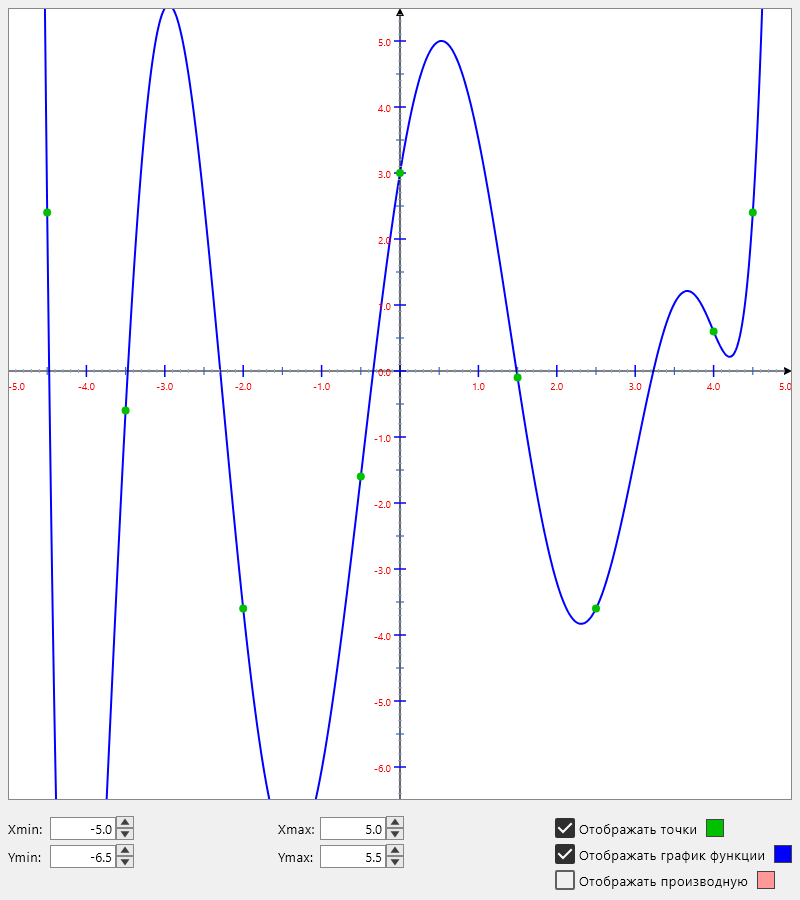

# Лабораторная работа №2. Построение графика интерполяционного полинома

Проект **lab2** — приложение для отображения графика интерполяционного полинома Ньютона,
построенное по заданию лабораторной работы №2 на основе проекта `PolynomialPainter`
(Compose Multiplatform, модули `shared` + `desktopApp`).

Пакет с исходным кодом: `ru.gr05405`.

## Что сделано по пунктам задания

1. **Класс `Converter`** (`ru.gr05405.painting.convertation`) — преобразование координат
   из декартовой системы в экранную и обратно: `xCrtToScr`, `xScrToCrt`, `yCrtToScr`, `yScrToCrt`.
   При преобразовании Y учитывается, что экранная ось направлена вниз.
2. **Тесты на JUnit 6** для всех методов `Converter` — `shared/src/jvmTest/.../ConverterTest.kt`
   (параметризованные тесты, проверка границ отрезка, середины, обратимости преобразования,
   линейности и зависимости от масштаба области вывода).
3. **Графический интерфейс** (рис. 1 задания): окно «Построение графика полинома», область
   вывода графика сверху, панель управления снизу.
4. **Границы отрезков** — поля `Xmin`, `Xmax`, `Ymin`, `Ymax` с кнопками «вверх»/«вниз»,
   шаг изменения `0.1`; нижняя граница всегда остаётся хотя бы на `0.1` меньше верхней;
   значения ограничены отрезком `[-100; 100]`. Ограничения реализованы в `MainViewModel`.
5. **«Галочки»** выбора отображаемых элементов с фиксированными цветами:
   точки — зелёные, график функции — синий, производная — розовая.
6. **`CartesianPainter`** (реализует интерфейс `Painter`) — оси со стрелками, штрихи с шагом `0.1`,
   отдельно выделены деления, кратные `0.5` и `1.0`, подписи к осям. Шаг штрихов и подписей
   автоматически подстраивается под масштаб (дополнительная часть задания): при мелком
   масштабе штрихи не сливаются, а подписи не накладываются друг на друга.
7. **`FunctionPainter`** (реализует `Painter`) — вывод графика функции. Вывод оптимизирован:
   значение функции вычисляется один раз на пиксельный столбец, все точки складываются
   в один `Path` и рисуются одним вызовом `drawPath`, точки за пределами области вывода
   не рисуются, разрывы графика не соединяются вертикальными линиями.
8. **`PointsPainter`** (реализует `Painter`) — отрисовка узлов интерполяции, через которые
   проходит полином Ньютона.
9. **Полином Ньютона** (`NewtonInterpolated`, `Polynomial`, `Point`, интерфейсы
   `Interpolated`/`PolynomialInterpolated`) вместе с тестами перенесён из лабораторной работы №1
   (JUnit 6: `NewtonInterpolatedTest`, `PolynomialTest`).
10. **Архитектура MVVM** — см. ниже.

## Архитектура MVVM

```
Model        ru.gr05405.math.polynomial            — полином и интерполяция (данные и вычисления)
             ru.gr05405.painting.convertation      — область вывода (Plane) и Converter
ViewModel    ru.gr05405.viewmodel.MainViewModel    — состояние окна и команды его изменения
View         ru.gr05405.ui.App, ControlPanel       — Compose-интерфейс
             ru.gr05405.painting.*Painter          — отрисовка элементов графика
desktopApp   ru.gr05405.MainKt                     — точка входа, окно приложения
```

`MainViewModel` хранит границы отрезков, флаги отображаемых элементов, узлы интерполяции
и сам полином, и предоставляет команды: `changeBound`, `setBound`, `onShowPointsChange`,
`onShowFunctionChange`, `onShowDerivativeChange`, `onCanvasSizeChange`. Модель представления
не содержит кода отображения: View только читает её состояние, вызывает команды и передаёт
данные объектам-отрисовщикам `Painter`.

## Структура проекта

```
lab2/
├── build.gradle.kts
├── settings.gradle.kts
├── gradle/libs.versions.toml
├── shared/                                  — общий модуль (логика и интерфейс)
│   └── src/
│       ├── commonMain/kotlin/ru/gr05405/
│       │   ├── math/                        — полином, интерполяция Ньютона
│       │   ├── painting/                    — Painter, CartesianPainter, FunctionPainter, PointsPainter
│       │   │   └── convertation/            — Converter, Plane
│       │   ├── viewmodel/                   — MainViewModel, ValueType
│       │   └── ui/                          — App, ControlPanel, GraphColors
│       └── jvmTest/kotlin/ru/gr05405/       — тесты на JUnit 6
└── desktopApp/                              — модуль запуска приложения
    └── src/main/kotlin/ru/gr05405/Main.kt
```

## Запуск

Из папки `lab2`:

```
gradlew.bat run
```

или явно:

```
gradlew.bat :desktopApp:run
```

## Тесты

```
gradlew.bat test
```

или только тесты общего модуля:

```
gradlew.bat :shared:jvmTest
```

Тесты написаны на JUnit 6 (`org.junit.jupiter:junit-jupiter:6.0.0`) и лежат в
`shared/src/jvmTest`. Отчёт о тестах: `shared/build/reports/tests/jvmTest/index.html`.

Набор тестов: `ConverterTest` (36 тестов — все методы `Converter`), `NewtonInterpolatedTest` (8),
`PolynomialTest` (34), `MainViewModelTest` (8 — шаг 0.1, минимальный зазор, границы `[-100; 100]`).
Всего 86 тестов, все проходят.

## Примечание о кодировке (Windows)

В `gradle.properties` указано `org.gradle.jvmargs=... -Dfile.encoding=COMPAT`.
Это связано с особенностью Gradle на Windows: список классов для процесса тестов
записывается во временный файл в UTF-8, а JVM читает его в системной кодировке.
Если путь к проекту содержит русские буквы (как папка «лаба 2»), без этой настройки
тесты падают с `ClassNotFoundException`. `COMPAT` включает системную кодировку —
так запись и чтение файла совпадают. На пути без русских букв настройка не мешает.

## Скриншот


